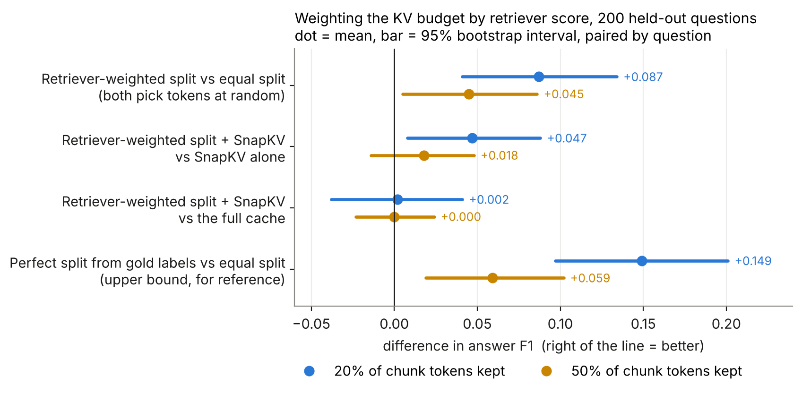
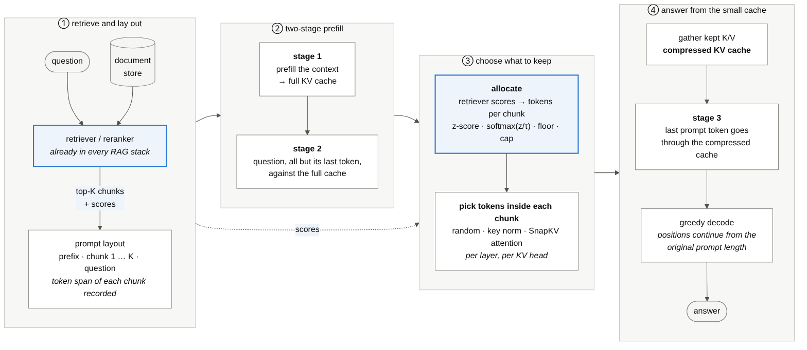
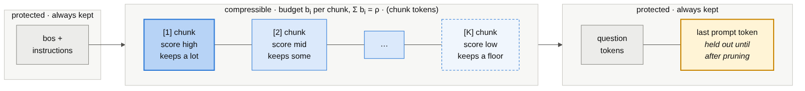
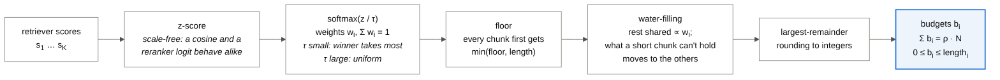
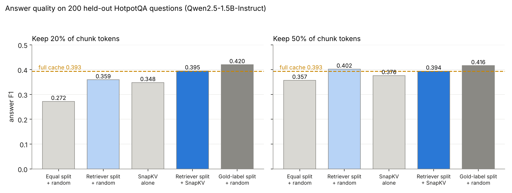
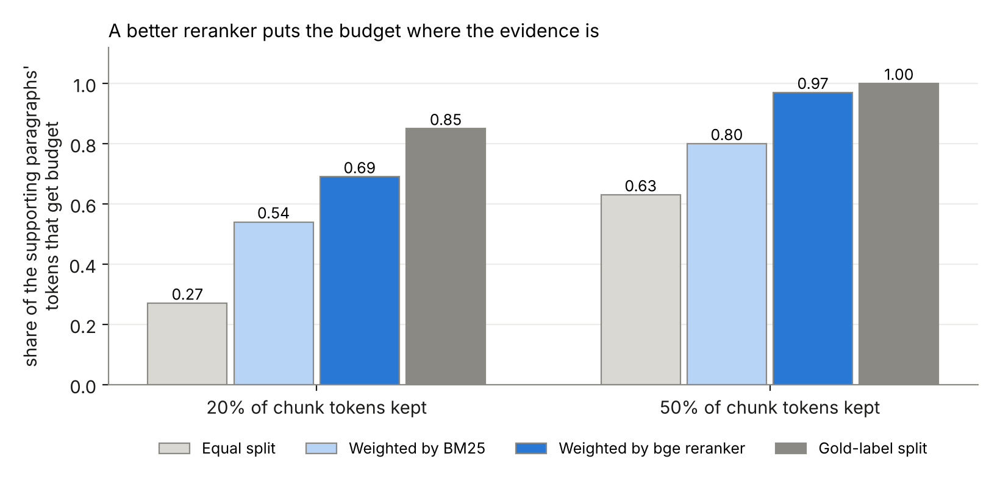
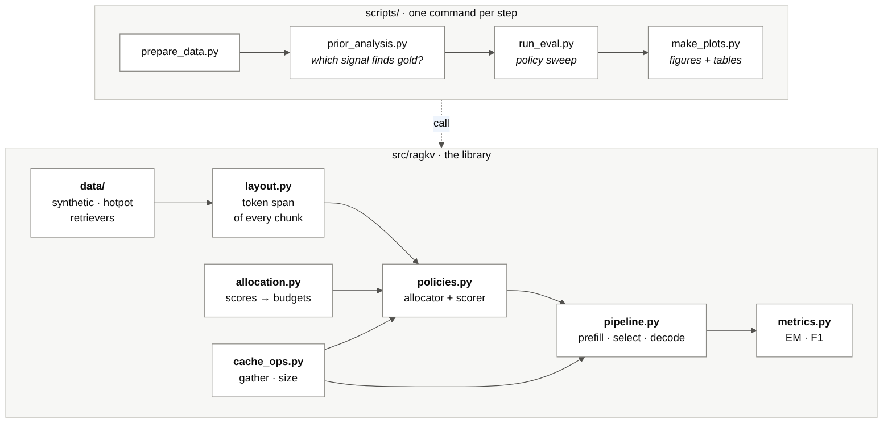

# ragkv

**Let the retriever decide how much KV cache each passage gets.**

A RAG system already scores every passage it retrieves. ragkv uses that score a second time: it splits a fixed KV-cache budget across the passages in proportion to their scores, so passages that look relevant keep most of their tokens and the rest keep only a few.

With a strong reranker, and SnapKV choosing which tokens to keep inside each passage, answer quality in our tests was indistinguishable from the full cache while holding only a fifth of the passage tokens.

---

## What we found

> **Setup for these numbers:** Qwen2.5-1.5B-Instruct, HotpotQA (distractor setting, ten passages per question), passages scored by `BAAI/bge-reranker-base`, 200 held-out questions, answer F1.

**1. Splitting the budget by retriever score beats splitting it equally.**
Keeping 20% of the passage tokens, with tokens chosen at random inside each passage, F1 goes from **0.272 to 0.359** (+0.087, 95% interval +0.041 to +0.134). This version never looks at attention weights, so it works with fused attention kernels.

**2. With SnapKV choosing tokens inside each passage, the compressed cache scores the same as the full cache.**
At 20% of passage tokens, F1 is **0.395 against 0.393 for the full cache**. The paired difference is +0.002 (interval -0.038 to +0.041), so no loss was measurable at this sample size. The same split also beats SnapKV on its own, 0.395 against 0.348 (+0.047, interval +0.008 to +0.088).

**3. The quality of the reranker decides how much you gain.**
At a 20% budget, the share of the supporting paragraphs' tokens that receive budget is **0.27 for an equal split, 0.54 weighted by BM25, 0.69 weighted by the bge reranker, and 0.85 for a perfect split** built from the gold labels.

**4. The cache gets much smaller.**
Averaged over the 20% and 50% budgets, the KV cache dropped from 79.5 MB to 29.3 MB per question (63% smaller).



---

## The idea



Attention-based eviction (H2O, SnapKV) needs the attention matrix, which fused kernels such as FlashAttention never hand back. Attention-free scorers (key norm, learned gates) get around that, but they know nothing about the question. A RAG system, though, has a relevance signal sitting unused: the retriever or reranker score of each passage.

ragkv works in two steps.

1. **Allocate** a token budget to each passage from its retriever score.
2. **Select** which tokens to keep inside each passage with a scorer of your choice: random, key norm, or SnapKV's question attention.

Step 1 is the idea. Step 2 is pluggable.

### How a prompt is laid out



The prefix and the question are never evicted. Only passage tokens compete for the budget. The last prompt token is **held out** until after pruning (the yellow box). Without that, the first answer token would be predicted from the full cache and every policy would look better than it is. For short-answer QA, that first token is most of the answer. The unit test `test_pruned_cache_equals_full_forward_with_evicted_keys_masked` checks that the pruned-cache logits equal a full forward pass in which the last query simply cannot see the evicted keys.

### From scores to budgets



Take the retriever scores `s` and z-score them: `z = (s - mean) / std`. The weights are `w = softmax(z / τ)`. Every passage first gets `min(floor, length)` tokens, and the rest of the budget is shared in proportion to `w`. If a short passage can't hold its share, the surplus flows to the others (water-filling). Rounding uses the largest-remainder rule, so the budgets add up exactly to the target `ρ · (passage tokens)`.

| knob | default | effect |
|---|---|---|
| `τ` (`--temperature`) | 1.0 | small: the top passage takes almost everything; large: close to an equal split |
| `floor` (`--floor`) | 8 | minimum tokens every passage keeps, so a mis-ranked gold passage isn't erased |
| `--weights` | `softmax` | `rank` uses `(rank+1)^(-1/τ)` and ignores score magnitudes |

The z-score means `τ` behaves the same for a cosine similarity and a cross-encoder logit. The runs below use `τ = 0.5` and `floor = 8`.

---

## Results in detail

### How the experiment was run

- **Model:** Qwen2.5-1.5B-Instruct, fp32, on a Colab T4.
- **Data:** HotpotQA in the distractor setting. Each question comes with ten paragraphs: the two that hold the supporting facts and eight distractors. Paragraph order is shuffled (seed 0).
- **Scores:** `BAAI/bge-reranker-base` (a cross-encoder), or BM25 where noted.
- **Budget:** 20% or 50% of the passage tokens. The prefix and the question are always kept on top.
- **Questions:** we picked `τ` on the first 200 questions, then measured on questions 200 to 399, which were never used to set it.
- **Score:** SQuAD-style F1, and the paired intervals are 95% bootstrap intervals over questions.

### Answer quality



| policy | 20% of passage tokens | 50% of passage tokens |
|---|---|---|
| full cache | 0.393 | 0.393 |
| equal split + random (`uniform+random`) | 0.272 | 0.357 |
| retriever split + random (`retriever+random`) | 0.359 | 0.402 |
| SnapKV alone (`global+snapkv`) | 0.348 | 0.376 |
| retriever split + SnapKV (`retriever+snapkv`) | 0.395 | 0.394 |
| gold-label split + random (`oracle+random`), upper bound | 0.420 | 0.416 |

### Paired differences

Each row compares two policies on the same questions, so these intervals are much tighter than comparing two averages.

| comparison | 20% | 50% |
|---|---|---|
| retriever split vs equal split (random inside) | +0.087 [+0.041, +0.134] | +0.045 [+0.005, +0.086] |
| retriever split + SnapKV vs SnapKV alone | +0.047 [+0.008, +0.088] | +0.018 [-0.014, +0.048] |
| retriever split + SnapKV vs full cache | +0.002 [-0.038, +0.041] | +0.000 [-0.023, +0.024] |
| gold-label split vs equal split (upper bound) | +0.149 [+0.097, +0.201] | +0.059 [+0.019, +0.102] |

Reproduce this table with [`scripts/paired_diff.py`](scripts/paired_diff.py).

### Why a better retriever helps



The chart measures where the budget goes: the share of the two supporting paragraphs' tokens that receive budget (first 200 questions, `τ = 0.5`). The bge reranker puts far more budget on the supporting paragraphs than BM25 does, and that is where the quality gain comes from.

With BM25 scores, the split helped only a little. On the first 200 questions, with key norm choosing tokens inside each passage, the retriever split scored 0.241 against 0.229 for an equal split at a 20% budget (a paired difference of +0.012, interval -0.028 to +0.052). Making the weighting sharper with BM25 added little: the share of supporting tokens that got budget moved only from 0.47 to 0.57 when `τ` dropped from 1.0 to 0.1.

### Choosing tokens inside a passage

Which scorer you use inside each passage matters.

- **Random** is a strong, simple choice and needs no attention weights. The retriever split with random selection reaches 0.359 at a 20% budget, in the same range as SnapKV alone (0.348).
- **SnapKV** is the best scorer here, and it stacks with the retriever split. It reads the question's attention weights, so it needs eager attention and does not work with fused kernels.
- **Key norm** (lowest key norm first) did no better than random on Qwen2.5. At a 50% budget, random beat it by +0.055 F1 (interval +0.012 to +0.100). Qwen2.5 uses biases in its key and value projections, which may be why key norm is a poor signal for it.

<details>
<summary>The full first-sweep table (BM25 scores, first 200 questions)</summary>

Cells show mean F1 with a 95% bootstrap interval.

| policy | 20% | 50% |
|---|---|---|
| full cache | 0.358 [0.307, 0.411] | 0.358 [0.307, 0.411] |
| key norm (global) | 0.197 [0.159, 0.236] | 0.247 [0.203, 0.295] |
| random (global) | 0.216 [0.173, 0.259] | 0.303 [0.253, 0.354] |
| SnapKV (global) | 0.294 [0.249, 0.343] | 0.343 [0.293, 0.395] |
| oracle + key norm | 0.339 [0.290, 0.391] | 0.349 [0.300, 0.401] |
| retriever + key norm | 0.241 [0.197, 0.288] | 0.298 [0.248, 0.349] |
| retriever + SnapKV | 0.294 [0.247, 0.346] | 0.331 [0.282, 0.382] |
| uniform + key norm | 0.229 [0.185, 0.275] | 0.278 [0.231, 0.325] |

</details>

### Cost

| | full cache | compressed (average of 20% and 50% budgets) |
|---|---|---|
| KV cache per question | 79.5 MB | 29.3 MB |
| selection time, once per question | n/a | 14 ms (`global` allocator) to 31 ms (per-passage allocators) |
| decode time per token | 42 ms | 42 to 43 ms |

These come from the first sweep (fp32, T4, prompts of roughly 1.5k tokens, one question at a time). At that length the model's weights, not the cache, dominate decoding on this GPU, so decode speed did not change. What you gain here is memory.

---

## Policies

A policy name is `allocator+scorer`. The baselines fall out as special cases.

| allocator ↓ / scorer → | `knorm` | `recency` | `random` | `snapkv` |
|---|---|---|---|---|
| `global` (no passage structure) | key-norm eviction | StreamingLLM-style | random | **SnapKV** |
| `uniform` (equal share per passage) | `uniform+knorm` | | `uniform+random` | |
| `retriever` | `retriever+knorm` | | **`retriever+random`** | **`retriever+snapkv`** |
| `oracle` (gold passages only) | upper bound | | `oracle+random` | |
| needs attention weights? | no | no | no | **yes** |

Aliases: `ours`, `snapkv`, `knorm`, `streaming`, `random`. Note that `ours` is shorthand for `retriever+knorm`, which is not the strongest variant; use the names above for the best results. Any allocator and scorer combination is accepted. `scripts/make_plots.py` has colour slots for the eight policies in its default sweep and asks you to add a slot for anything else.

---

## Quickstart

This runs anywhere, including a laptop, with no downloads. The tiny model has random weights, so its F1 is 0 everywhere. It only proves the plumbing works.

```bash
pip install -e ".[dev]"
pytest                                    # 72 tests

python scripts/prepare_data.py --source synthetic --n 200 --out data/syn.jsonl
python scripts/run_eval.py --model tiny-random --data data/syn.jsonl --out results/smoke.jsonl \
    --policies full global+knorm uniform+knorm retriever+knorm --ratios 0.2 0.5 --max-new-tokens 6
python scripts/make_plots.py --results results/smoke.jsonl --out results/smoke
```

### Reproduce the headline numbers (GPU and internet)

```bash
pip install -e ".[eval]"

# 500 questions scored by the bge reranker
python scripts/prepare_data.py --source hotpot --n 500 --retriever BAAI/bge-reranker-base --out data/hotpot_bge.jsonl

# the last 300 questions; --n 200 below uses questions 200 to 399
tail -n 300 data/hotpot_bge.jsonl > data/hotpot_bge_heldout.jsonl

python scripts/run_eval.py --model Qwen/Qwen2.5-1.5B-Instruct --data data/hotpot_bge_heldout.jsonl \
    --n 200 --seed 0 --dtype float32 --temperature 0.5 \
    --policies full retriever+random retriever+snapkv uniform+random global+snapkv oracle+random \
    --ratios 0.2 0.5 --out results/qwen_bge_heldout.jsonl

python scripts/paired_diff.py --results results/qwen_bge_heldout.jsonl \
    --pair retriever+random:uniform+random --pair retriever+snapkv:global+snapkv \
    --pair retriever+snapkv:full --pair oracle+random:uniform+random --ratios 0.2 0.5
```

`run_eval.py` appends one JSON line per (question, policy, budget) and skips what is already in the output file, so a dead Colab session loses nothing. Expect roughly 30 to 40 minutes for 200 questions on a T4. To redraw the figures in this README without a GPU, run `python docs/make_result_figures.py`.

### Tips for Colab and Kaggle

- **Use `--dtype float32` for Qwen2.5 on a T4.** In fp16 the keys come out as NaN, and every signal that depends on them is NaN too. A 1.5B model fits in fp32.
- **In a notebook, `import ragkv` can pick up the wrong folder.** If `ragkv.__file__` prints `None`, run `import sys; sys.path.insert(0, "/content/ragkv/src")` and import again. Running the scripts with `!python scripts/...` avoids the problem.
- **Llama needs a Hugging Face token** with access to the gated repo. Qwen does not.
- **`snapkv` forces eager attention,** which uses more memory. If it runs out, lower `--n` or drop the `snapkv` policies.
- **Which signal finds the supporting passages?** `scripts/prior_analysis.py` runs each prompt once with attention on and reports, per signal, how well it separates supporting passages from distractors (AUROC with a bootstrap interval): the retriever score, the question's attention, key norm, and two sanity checks.

---

## Repo layout



```
src/ragkv/
  layout.py       token span of every chunk, so budgets map to positions
  allocation.py   scores -> weights -> integer budgets        (numpy only)
  policies.py     allocator + scorer; returns the positions to keep per layer and KV head
  cache_ops.py    the only file that touches the KV-cache internals (version-sensitive)
  pipeline.py     prefill -> select -> decode, with the held-out last token
  metrics.py      SQuAD-style EM / F1
  tiny.py         offline random Llama/Qwen2 + char tokenizer for tests and smoke runs
  data/           synthetic QA, HotpotQA, BM25 / cross-encoder scoring
scripts/          prepare_data · prior_analysis · run_eval · paired_diff · make_plots
tests/            72 tests
docs/             diagram sources (.mmd), rendered images, make_result_figures.py
```

Each KV head keeps its own set of positions, chosen per layer. Kept keys stay rotated by the position they were computed at, and new tokens keep counting from the original prompt length, so nothing needs re-encoding.

### What the tests check

- The budget allocator: sums, caps, floors, scale-freeness and ordering.
- The two-stage prefill gives the same result as a single forward pass (Llama-style and Qwen2-style models, with grouped-query attention).
- Pruned-cache logits equal a full forward pass with the evicted keys masked out. The test also fails if positions are wrong.
- Full-cache decoding equals `model.generate`.
- Policies hit their budgets exactly, never evict the prefix or the question, and keep the right per-passage counts for every head.
- fp16 and bf16 runs work, and the cache size halves.

---

## Related work

The closest work I found, from a search that was not exhaustive:

- **Attention-free, kernel-compatible eviction already exists.** Key-norm eviction (Devoto et al., 2024), EpiKV, PagedEviction and KVP all avoid the attention matrix.
- **Chunk-level relevance in RAG caches has been used for other purposes.** Cache-Craft manages reusable chunk caches by relevance, and CacheClip uses an auxiliary model to choose which tokens to recompute when reusing chunk caches.
- **What I did not find** is a method that takes the retriever's own scores as the budget prior for token eviction inside a single prompt. That is the idea tested here. KV-cache papers arrive quickly, so check again before relying on this.

The baselines reimplemented here come from SnapKV (Li et al., 2024) and StreamingLLM (Xiao et al., 2023).

---

## Reading the numbers

- **Everything above comes from one model, one dataset and one paragraph order per question.** The intervals cover 200 questions, so differences smaller than about 0.04 F1 can't be told apart from noise. Average F1 also differs between question sets (the full cache scored 0.358 on the first 200 and 0.393 on the next 200), so compare policies within a set, using the paired differences.
- **The score depends on the reranker.** The method can only be as good as the scores it gets. The gold-label split bounds it from above, and the BM25 results show what a weaker retriever gives. The reranker adds a scoring step, though most RAG stacks already run one.
- **Gold labels are heuristic.** HotpotQA's two supporting paragraphs count as gold. Passages that help without being labelled count against every method equally.
- **Position effects.** The default shuffle avoids letting passage order help or hurt one policy more than another. `--order rank` and `--order reverse_rank` are there to test that.
- **Prompt format.** Answers come from a raw-text prompt, not a chat template, so absolute F1 for this small model is modest. The same prompt is used for every policy.
- **`retriever+snapkv` reads attention weights.** Only the retriever split with `random` or `knorm` is attention-free.
