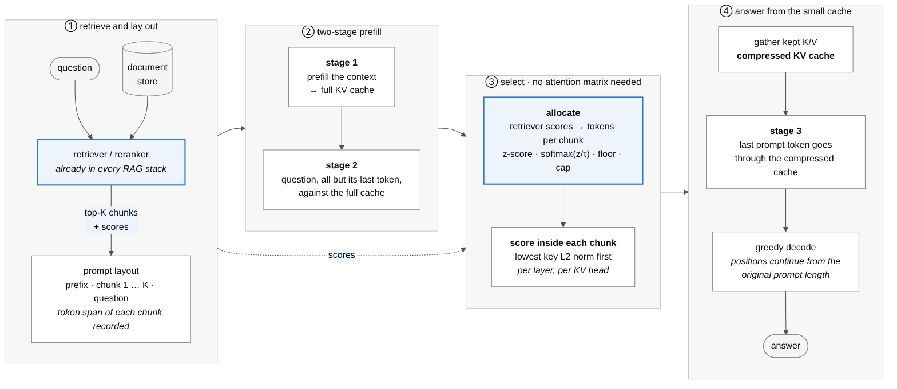
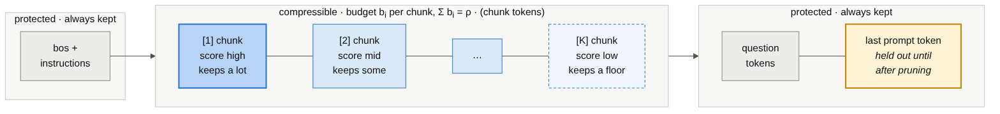
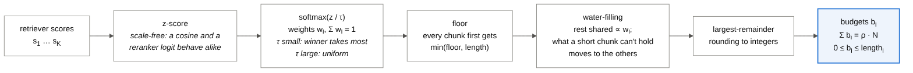
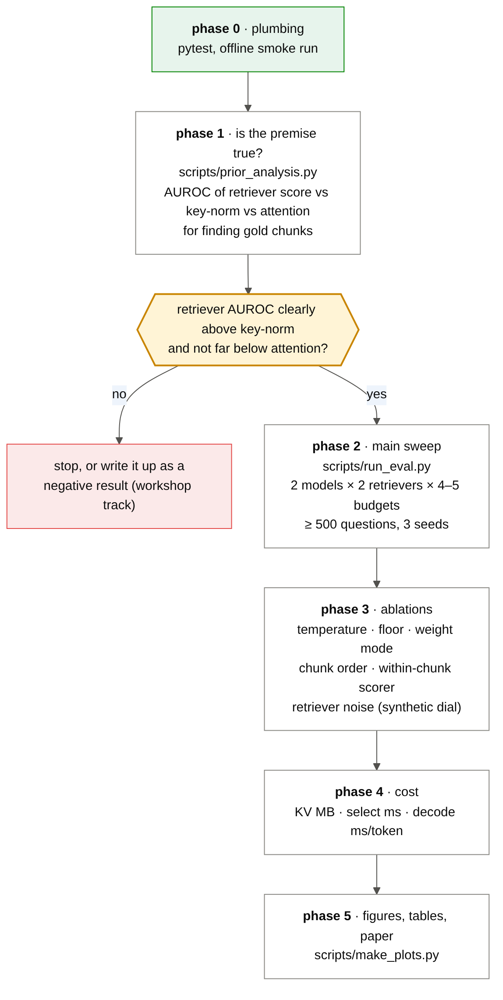
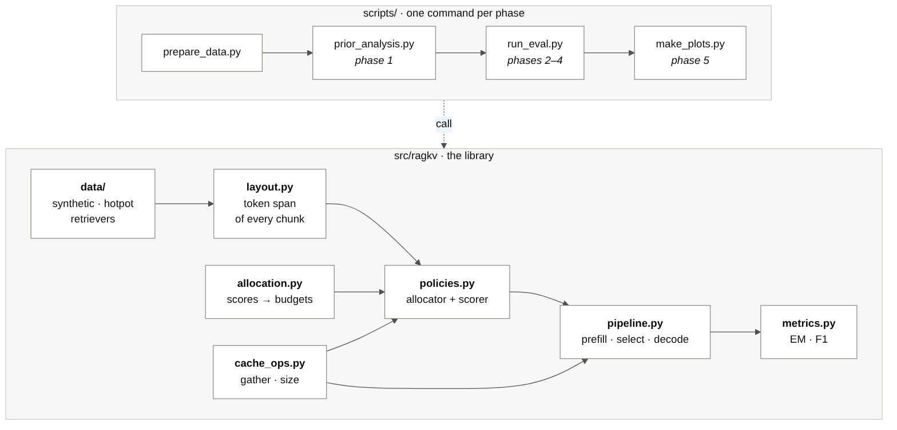

# ragkv

**Retrieval scores as a free prior for KV-cache budgeting in RAG.**

A RAG pipeline already scores every chunk it retrieves. `ragkv` asks whether that score can decide how much of each chunk's KV cache to keep, instead of estimating importance from attention statistics or key norms alone.

> **Status, read this first.** The library, the evaluation harness and the plotting are finished and tested (72 tests, plus an end-to-end run on an offline tiny model). **No result about the method has been measured yet.** The sandbox this was built in has no GPU and cannot reach Hugging Face, so the real-model experiments are the part you run on Kaggle or Colab ([`notebooks/run_on_gpu.ipynb`](notebooks/run_on_gpu.ipynb)). The method may well fail; phase 1 below is designed to find that out cheaply. See [What has and has not been verified](#what-has-and-has-not-been-verified).

---

## The idea



Attention-based eviction (H2O, SnapKV) needs the attention matrix, which fused kernels such as FlashAttention never return. Attention-free scorers (key norm, learned gates) fix that but know nothing about the *question*. A RAG system, however, has a relevance signal sitting unused: the retriever or reranker score of each chunk.

The method has two parts.

1. **Allocate** a token budget to each chunk from its retriever score.
2. **Select** which tokens to keep inside each chunk with a cheap attention-free scorer (lowest key L2 norm first).

Nothing in step 1 or 2 touches an attention matrix, so it works with fused attention kernels and with paged KV caches.

### How a prompt is laid out



The prefix and the question are never evicted; only chunk tokens compete for the budget. The last prompt token is **held out** until after pruning (the yellow box). Otherwise the first answer token would be predicted from the full cache and every policy would look better than it is. For short-answer QA that first token is most of the answer. The unit test `test_pruned_cache_equals_full_forward_with_evicted_keys_masked` checks that the pruned-cache logits equal a full forward pass in which the last query simply cannot see the evicted keys.

### From scores to budgets



With retriever scores `s`, z-scored `z = (s - mean) / std`, the weights are `w = softmax(z / τ)`. Every chunk first receives `min(floor, length)` tokens, and the rest of the budget is shared in proportion to `w`. Anything a short chunk cannot hold flows to the others (water-filling). Integer rounding is largest-remainder, so the budgets sum exactly to the target `ρ · (chunk tokens)`.

| knob | default | effect |
|---|---|---|
| `τ` (`--temperature`) | 1.0 | small: the top chunk takes almost everything; large: uniform |
| `floor` (`--floor`) | 8 | minimum tokens every chunk keeps, so a mis-ranked gold chunk is not erased |
| `--weights` | `softmax` | `rank` uses `(rank+1)^(-1/τ)` and ignores score magnitudes |

The z-score makes `τ` mean the same thing for a cosine similarity and a cross-encoder logit.

---

## Policies

A policy name is `allocator+scorer`. Baselines fall out as special cases.

| allocator ↓ / scorer → | `knorm` | `recency` | `random` | `snapkv` |
|---|---|---|---|---|
| `global` (no chunk structure) | key-norm eviction | StreamingLLM-style | random | **SnapKV** |
| `uniform` (equal share) | `uniform+knorm` | | | |
| `retriever` | **`retriever+knorm` (ours)** | | | `retriever+snapkv` |
| `oracle` (gold chunks only) | upper bound for a perfect retriever | | | |

Aliases: `ours`, `snapkv`, `knorm`, `streaming`, `random`. Any combination of the lists is accepted; `scripts/make_plots.py` has colour slots for the eight in the table above and asks you to add a slot for anything else.

---

## Quickstart

Runs anywhere, including a laptop, with no downloads. The tiny model has random weights, so its F1 is 0 everywhere; this only proves the plumbing.

```bash
pip install -e ".[dev]"
pytest                                    # 72 tests

python scripts/prepare_data.py --source synthetic --n 200 --out data/syn.jsonl
python scripts/run_eval.py --model tiny-random --data data/syn.jsonl --out results/smoke.jsonl \
    --policies full global+knorm uniform+knorm retriever+knorm --ratios 0.2 0.5 --max-new-tokens 6
python scripts/make_plots.py --results results/smoke.jsonl --out results/smoke
```

Real run (GPU, internet):

```bash
pip install -e ".[eval]"
python scripts/prepare_data.py --source hotpot --n 500 --retriever bm25 --out data/hotpot_bm25.jsonl
python scripts/prepare_data.py --source hotpot --n 500 --retriever BAAI/bge-reranker-base --out data/hotpot_bge.jsonl

python scripts/prior_analysis.py --model Qwen/Qwen2.5-1.5B-Instruct --data data/hotpot_bm25.jsonl \
    --n 300 --out results/prior_qwen_bm25.json

python scripts/run_eval.py --model Qwen/Qwen2.5-1.5B-Instruct --data data/hotpot_bm25.jsonl --n 500 \
    --policies full global+knorm global+recency global+random uniform+knorm retriever+knorm oracle+knorm global+snapkv \
    --ratios 0.1 0.2 0.3 0.5 --out results/qwen_bm25.jsonl
python scripts/make_plots.py --results results/qwen_bm25.jsonl --out results/qwen_bm25
```

`run_eval.py` appends one JSON line per (example, policy, budget) and skips what is already in the output file, so a dead Colab session loses nothing. Run it several times with different `--seed` values into the same file: seeds reshuffle the chunk order and `make_plots.py` averages them per question.

---

## The experiment plan



**Phase 1 is the gate.** `prior_analysis.py` runs each prompt once with attention on and reports, per signal, how well it separates gold chunks from distractors (AUROC, bootstrap CI):

| signal | what it is | needs attention? |
|---|---|---|
| `retriever` | the score handed to us | no |
| `attn_mass` | attention the question tokens pay to the chunk | yes |
| `attn_dens` | the same, per token | yes |
| `neg_knorm` | minus the chunk's mean key norm | no |
| `length`, `random` | sanity checks, should sit near 0.5 | no |

How to read it:

* `retriever` clearly above `neg_knorm` → the prior carries information the attention-free signal lacks. Continue.
* `retriever` near `attn_mass` → attention-quality guidance for free. The best case.
* `retriever` at or below `neg_knorm` → stop, or write it as a negative result.
* `neg_knorm` near 0.5 → key norm is a poor within-chunk scorer for this model. The link between low key norm and high attention was reported on Llama-family models, as far as I know; **it is not guaranteed for Qwen2.5**, which has QKV biases. In that case lead with `retriever+snapkv`, or accept that the within-chunk scorer is the weak link.

**Ablations** (phase 3) are all flags of `run_eval.py`: `--temperature`, `--floor`, `--weights`, `--order {shuffle,rank,reverse_rank,original}`. The synthetic generator has a retriever-noise dial (`prepare_data.py --noise`), which is how to show where the method degrades as the retriever gets worse.

**Hardware.** FlashAttention-2 needs an Ampere-or-newer GPU, so it is unavailable on a T4 or P100 and the code uses PyTorch SDPA there. `snapkv` forces eager attention, which costs more memory; if it runs out, drop it or lower `--n`. For the paper's latency table, use an A100/L4 if you can get one and say which GPU produced each number.

---

## Repo layout



```
src/ragkv/
  layout.py       token span of every chunk, so budgets map to positions
  allocation.py   scores -> weights -> integer budgets        (numpy only)
  policies.py     allocator + scorer; returns the positions to keep per layer and KV head
  cache_ops.py    the only file that touches the KV-cache internals (version-sensitive)
  pipeline.py     prefill -> select -> decode, with the held-out last token
  metrics.py      SQuAD-style EM / F1
  tiny.py         offline random Llama/Qwen2 + char tokenizer for tests and smoke runs
  data/           synthetic QA, HotpotQA, BM25 / cross-encoder scoring
scripts/          prepare_data · prior_analysis · run_eval · make_plots
tests/            72 tests
docs/             diagram sources (.mmd) and rendered images; ./render_diagrams.sh rebuilds them
```

Each KV head keeps its own set of positions, chosen per layer. Kept keys stay rotated by the position they were computed at, and new tokens continue counting from the original prompt length, so no re-encoding is needed.

---

## Related work, and what is and is not new

Closest work I found, from a search that was not exhaustive:

* **Attention-free, kernel-compatible eviction is not new.** Key-norm eviction (Devoto et al., 2024), EpiKV, PagedEviction and KVP all avoid the attention matrix.
* **Chunk-level relevance in RAG caches exists, for other purposes.** Cache-Craft manages reusable chunk caches by relevance; CacheClip uses an auxiliary model to choose which tokens to recompute when reusing chunk caches.
* **What I did not find** is a method that takes the retriever's own scores as the budget prior for within-prompt token eviction. That is the claim to defend, and it is a moderate contribution, not a groundbreaking one. Before submitting, repeat the literature search for the last few months; KV-cache papers arrive quickly.

Cite SnapKV (Li et al., 2024) and StreamingLLM (Xiao et al., 2023) for the baselines this repo reimplements.

## Threats to validity

* **Retriever quality.** The method can only be as good as the scores. The oracle policy bounds it from above; the noise dial shows the slope.
* **Position bias.** With `--order rank` the best chunk is first, which lets recency and sink effects help or hurt. The default shuffle avoids confounding; report `rank` and `reverse_rank` as ablations.
* **Gold labels are heuristic.** HotpotQA's two supporting paragraphs are gold; chunks that help without being labelled count against every method equally.
* **Answers come from a raw-text prompt, not a chat template.** Instruct models can behave differently with a template. Keep one prompt format across all policies.
* **BM25 on HotpotQA is a strong signal** because questions share rare terms with the gold paragraphs. Report the cross-encoder runs too, and the synthetic dial for weak retrievers.

## What has and has not been verified

| | status |
|---|---|
| Budget allocator: sums, caps, floors, scale-freeness, ordering | tested (unit + edge cases) |
| Two-stage prefill equals a single forward pass | tested, Llama-style and Qwen2-style, GQA |
| Pruned-cache logits equal "evicted keys masked out" | tested; the test also fails if positions are wrong |
| Full-cache decoding equals `model.generate` | tested |
| Policies: budgets hit exactly, prefix/question never evicted, per-chunk counts per head | tested |
| fp16 / bf16 run, cache size halves | tested on CPU |
| Resume-on-restart, multi-seed merging, plotting | exercised end to end on the tiny model |
| **Any measurement of F1 / EM / AUROC on a real model** | **not run** (no GPU, Hugging Face blocked in the build sandbox) |
| HotpotQA loader, cross-encoder scoring, `load_model` for real checkpoints | **untested**, written against the library APIs |
| Latency and memory on real hardware | **not measured** |

The first thing to do on a real machine is `pytest`, then phase 1. If a real-model API difference breaks something, it will be in `modeling.py`, `data/hotpot.py` or `cache_ops.py`, which are the only files that depend on external version details.
